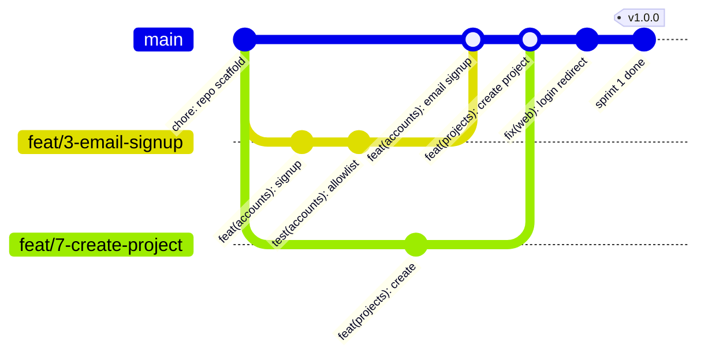

# CI/CD and Branching

## Branching: GitHub Flow + release tags

- `main` is protected: PR required, 1 approving review, CI green, linear history, squash merge only, no force push.
- One branch per issue, named by type:
  - `feat/<issue>-slug` e.g. `feat/14-swipe-deck`
  - `fix/<issue>-slug`, `chore/<issue>-slug`, `docs/<issue>-slug`
- Commits follow Conventional Commits: `feat(matching): lock team when last role filled`. Scopes are app or feature names (`accounts`, `profiles`, `projects`, `matching`, `chat`, `web`, `infra`, `docs`).
- The squash commit title is the PR title, so the PR title must be a valid conventional commit.
- PR body uses the template: summary, `Closes #<issue>`, how it was tested, and a `Reviewer: @name` line (the course check-in notes need the reviewer).
- Keep PRs small (aim under 400 changed lines, not counting generated client).
- End of each sprint: tag `main` as `v<sprint>.<minor>.0` (e.g. `v1.0.0` after Sprint 1). The tag triggers the release.

### Example

Squash merges show up as a single commit on `main`.

## CI (`.github/workflows/ci.yml`)

Runs on every PR and on push to `main`. On a PR, `concurrency` cancels the older run when you push again. Every commit on `main` gets its own run, so a quick second merge doesn't cancel the first one's run and turn the badge red. `permissions: contents: read`.

| Job | Steps | Fails when |
|---|---|---|
| `detect` | checks `backend/` and `frontend/` exist | never |
| `backend` | uv sync, `ruff check`, `ruff format --check`, `pytest` with Postgres 17 and Redis 8 service containers, then regenerate `schema.yml` and `git diff --exit-code` | lint or tests fail, or `schema.yml` not committed after an API change |
| `frontend` | pnpm install (frozen lockfile), `eslint`, `tsc --noEmit`, `vitest`, `next build`, then regenerate `packages/api-client` and `git diff --exit-code` | lint, types, tests or build fail, or the client is out of date |
| `docker` | buildx build `backend/Dockerfile` and `frontend/Dockerfile`, no push | an image does not build |
| `secrets` | gitleaks over the commits in the PR or push | a secret is found |

Branch protection requires all five jobs. `make check` runs the same checks locally.

Playwright e2e for the golden path runs on `main` and nightly (added in Sprint 3), not on every PR, to keep PR CI fast.

Dependabot opens weekly PRs for uv (`backend/`), npm (`frontend/`) and GitHub Actions.

## Release (`.github/workflows/release.yml`)

On push of a tag matching `v*`:

1. Checkout, set up buildx, log in to GHCR with `GITHUB_TOKEN` (`permissions: packages: write`).
2. Build and push:
   - `ghcr.io/season101/teammatch-api`
   - `ghcr.io/season101/teammatch-web`
3. Tags from `docker/metadata-action`: `1.2.0` and `1.2`, plus `latest` (the action adds it for every semver tag).
4. The `release` job runs after both images are pushed. It creates a GitHub Release for the tag with notes generated from the squash commits, or keeps the one that's there if the Release was made with GitHub's "Draft a new release" button (`permissions: contents: write` on that job only).
5. The `deploy` job calls `deploy.yml` (below) with the tag's version.

The repo is public, so the images are public and the host can pull without logging in.

## Deploy (`.github/workflows/deploy.yml`)

Called by `release.yml` after each release. Run it by hand from the Actions tab (on `main`, with a version like `1.0.4`) to redeploy or roll back to a version that's already released.

1. The job uses the `production` environment, so it waits until season101 approves it. The environment only accepts `v*` tags and `main`.
2. It connects with `ssh` to `ssh.sijancodes.com:2222` as season101, using the environment secrets `DEPLOY_SSH_KEY` and `DEPLOY_KNOWN_HOSTS`, and sends only the version.
3. On the host, that key can only run `~/bin/teammatch-deploy` (a copy of `deploy/deploy.sh`). The script:
   - backs up the database to `~/backups`,
   - fetches the tag and checks out `apps/teammatch` at it,
   - sets `TEAMMATCH_VERSION` in `deploy/.env`,
   - pulls and restarts only `teammatch-migrate`, `teammatch-api` and `teammatch-web`,
   - waits about 2 minutes for `/api/v1/health/` to say `ok` with the new version.
4. If any step after the checkout fails, the script puts the previous checkout and version back, restarts the same three services, and the job fails.

`concurrency` keeps it to one deploy at a time, and the script takes a `flock` too. Its output shows in the Actions log and in `~/teammatch-deploy.log` on the host. The badge on the README shows the latest `production` deployment. Host setup is in [deploy/README.md](../../deploy/README.md#one-time-setup).

## Wiki (`.github/workflows/wiki.yml`)

Runs when `docs/`, `README.md`, `deploy/README.md` or `packages/api-client/README.md` change. `.github/scripts/build_wiki.py` turns each doc into a wiki page, rewrites links between docs to point at wiki pages, and builds the sidebar. It fails when a link is broken or when a doc under `docs/` has no line in its `PAGES` list. On a PR the job only builds. On push to `main` it replaces the wiki's contents and pushes them with `GITHUB_TOKEN` (`permissions: contents: write`). Run it by hand from the Actions tab to undo edits someone made in the wiki itself.

## Manual deploy (fallback)

If Actions or the deploy key isn't working, deploy from your own SSH session. Either run the same script, `ssh sitashma '~/bin/teammatch-deploy 1.0.0'`, or follow the manual steps in [deploy/README.md](../../deploy/README.md#manual-steps). Both only move the `apps/teammatch` submodule. Never pull, commit or push the sitashma-infra repo itself, because it pins the other apps too.

Migrations must stay backward compatible for one release, so rolling back to the previous version works without restoring the database.

## Pipeline

```mermaid
flowchart LR
    dev["Developer<br/>feat/issue-slug branch"]
    pr["Pull request<br/>template + Reviewer line"]

    subgraph ci ["CI workflow"]
        direction TB
        be["backend<br/>ruff, pytest, schema drift"]
        fe["frontend<br/>eslint, tsc, vitest, build, client drift"]
        dk["docker<br/>build both images"]
        gl["gitleaks"]
    end

    review["1 approving review"]
    main["main<br/>squash merge"]
    tag["tag v*<br/>end of sprint"]

    subgraph rel ["Release workflow"]
        direction TB
        build["buildx build"]
        ghcr["push to GHCR<br/>teammatch-api, teammatch-web"]
        notes["GitHub Release notes"]
    end

    subgraph deploy ["Deploy workflow, automatic"]
        direction TB
        approve["approve<br/>production environment"]
        ssh["ssh, forced command<br/>teammatch-deploy X.Y.Z"]
        steps["backup, check out tag,<br/>compose pull + up"]
        verify["health ok on new version"]
        rollback["roll back to previous version"]
    end

    dev --> pr --> ci
    ci -->|"all green"| review --> main --> tag --> build --> ghcr --> notes
    notes --> approve --> ssh --> steps --> verify
    verify -.->|"fails"| rollback
```

