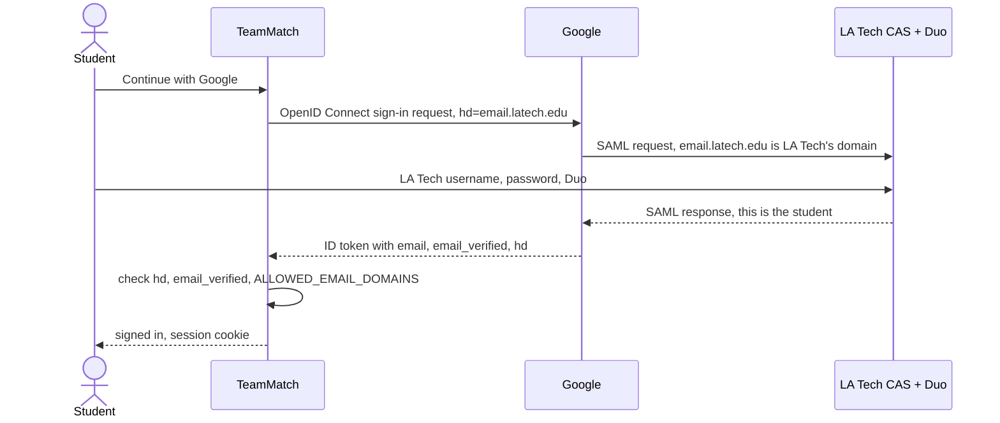

# Google Sign-In and Identity Federation

Students sign in with their LA Tech Google account (@email.latech.edu). Staff (@latech.edu) aren't on Google and use email and password. TeamMatch never sees an LA Tech password: LA Tech vouches for the student to Google, and Google vouches for them to TeamMatch.

Story F1-05 (#10), on top of the F1-06 domain allowlist (#11). Why it works this way: [ADR 0007](adr/0007-google-sign-in-trusts-la-tech-workspace.md). Request by request: [Main Flows, part 2](flows.md#2-google-sign-in-via-allauth-headless).

## Who can use it

| Address | Who | Mail runs on | LA Tech Google account | Sign in with Google |
|---|---|---|---|---|
| @email.latech.edu | Students | Google | Yes, Google Workspace, signed in through LA Tech's CAS | Yes |
| @latech.edu | Staff and faculty | LA Tech's own servers (`smtp*.latech.edu`) | No | No, email and password |
| anything else | | | | No, and no email signup either (BR-01) |

Checked on 2026-10-23: the mail (MX) records for `email.latech.edu` point to Google, and Google's sign-in page for that domain redirects to `cas.latech.edu`. For `latech.edu`, Google's page says the domain isn't on Google Workspace.

A staff member can create a personal Google account with their @latech.edu address, but TeamMatch refuses it. Google checked that address once, when the account was made, and doesn't control the mailbox. Google's own guide says it only vouches for an address that is Gmail, or that has `email_verified` true **and** an `hd` claim; otherwise it recommends a password or another check ([Verify the Google ID token](https://developers.google.com/identity/gsi/web/guides/verify-google-id-token), step 2).

## How the trust passes along

Identity federation means one system vouches for who a user is, so the next one doesn't keep its own password. Here it happens twice: LA Tech's CAS vouches to Google, and Google vouches to TeamMatch.

| Hop | Protocol | Run by | What TeamMatch sees |
|---|---|---|---|
| Student and LA Tech CAS | SAML 2.0, password and Duo | LA Tech IT | Nothing |
| Google and TeamMatch | OAuth 2.0 and OpenID Connect | Google, and allauth on our side | The ID token's claims |

So LA Tech decides who has an account, resets passwords, runs Duo and can block apps. TeamMatch decides only which tokens it accepts.

## What the server checks

Every Google sign-in, new or returning, goes through `SocialAccountAdapter.pre_social_login` in `backend/apps/accounts/adapter.py`.

| Check | Fails with | Why |
|---|---|---|
| ID token `hd` is `email.latech.edu` and `email_verified` is true | `google_account_not_allowed` | Only LA Tech's Workspace accounts carry that `hd`, so a personal Google account can't pass |
| Email domain is in `ALLOWED_EMAIL_DOMAINS` | `email_domain_not_allowed` | The same allowlist as email signup and sign-in (F1-06) |

- The required `hd` comes from `SOCIALACCOUNT_PROVIDERS["google"]["AUTH_PARAMS"]["hd"]` in `backend/config/settings/base.py`. Sent in the sign-in request, it only makes Google skip its account picker and go straight to LA Tech's login. Anyone can edit that request, so the token's claim decides ([Google's note on `hd`](https://developers.google.com/identity/openid-connect/openid-connect#hd-param)).
- A rejection comes back to the frontend as `/auth/callback?error=<code>&error_process=login`. Backing out at Google gives `error=cancelled`. A sign-in whose state expired lands on `/login?error=…`.
- allauth keys the Google account by the token's `sub`, not by email.

## Password and Google on one account

One email is always one account (`ACCOUNT_UNIQUE_EMAIL`). With `SOCIALACCOUNT_EMAIL_AUTHENTICATION` and `SOCIALACCOUNT_EMAIL_AUTHENTICATION_AUTO_CONNECT` on, a Google sign-in with the same verified email signs in to the existing account and links Google to it.

| You start with | Then you | What happens | Works afterward |
|---|---|---|---|
| Password, email verified | Continue with Google | Signed in to the same account, and Google is linked | Password and Google |
| Password, email never verified | Continue with Google | Signed in and linked, but allauth wipes the old password, in case someone else registered the student's address first | Google |
| Google | Sign in with email and password | Fails as a wrong password: an account made through Google has none | Google |
| Google | Sign up with email and password, same address | No second account. allauth tries to email a "you already have an account" message with a reset link | Google |
| Google | Reset the password, then sign in with it | allauth sends reset emails to Google-only accounts too | Password and Google |

Known gaps:

- Signing up again with an existing email currently returns a server error. allauth needs the reset-password page's address in `HEADLESS_FRONTEND_URLS["account_reset_password"]`, and that setting is missing.
- There are no reset-password pages yet, although reset emails already link to `/reset-password/<key>`. Until they exist, a Google-only account can't add a password.

## Where the sign-in comes back

`path("accounts/", include("allauth.urls"))` in `backend/config/urls.py` serves Google's callback. With `HEADLESS_ONLY` on, it adds only the provider callbacks, no allauth HTML pages.

| | Local | Prod |
|---|---|---|
| Callback registered at Google | `http://localhost:3000/accounts/google/login/callback/` | `https://teammatch.sijancodes.com/accounts/google/login/callback/` |
| How it reaches Django | Next rewrite of `/accounts/*` to the api (`frontend/next.config.ts`) | Traefik routes `/accounts` to the api (`deploy/teammatch.prod.yml`) |
| Host Django puts in the callback | `localhost:3000`, from `USE_X_FORWARDED_HOST` in `backend/config/settings/local.py` | The real host, and https from `SECURE_PROXY_SSL_HEADER` |

The address Django builds must match a registered one exactly, trailing slash included.

## Google Cloud setup

| Item | Value |
|---|---|
| Project | "TeamMatch", owned by Sijan's personal Google account. Not a student account: those are deleted after graduation, and LA Tech may block Google Cloud for them |
| OAuth client | Web application. Client ID `592460497046-6pqp925rnj7m86ipo38kcppsvkaag4bq.apps.googleusercontent.com` (public by design) |
| Client secret | Shown only once, when it's created. If it's lost, add a new secret on the client's page and update `deploy/.env` |
| Redirect URIs | The two callbacks above, plus `https://developers.google.com/oauthplayground` from the first test (safe to remove) |
| Scopes | `openid`, `email`, `profile` only |
| Audience | External, publishing status Testing |
| Environment | `GOOGLE_CLIENT_ID` and `GOOGLE_CLIENT_SECRET` on the api ([Deployment](deployment.md#environment-variables)). With no client ID, `/_allauth/browser/v1/config` lists no providers and the frontend shows no Google button |

Google's audience rules let an app that asks only for `openid`, `email` and `profile` stay in Testing without a test-user list, a warning screen or the 7-day expiry ([Manage App Audience](https://support.google.com/cloud/answer/15549945)). Adding any other scope ends that exemption. If an unlisted student is ever blocked, click **Publish app** on the Audience page. These scopes need no Google review, but uploading a logo starts brand verification, which takes days.

## Troubleshooting

| Symptom | Cause | Fix |
|---|---|---|
| Google shows `redirect_uri_mismatch` | Django built the callback with the wrong host, or http instead of https | Locally, check `USE_X_FORWARDED_HOST`. In prod, check the Traefik `/accounts` rule. Compare with the registered URI, trailing slash included |
| Google shows "Access blocked" with `admin_policy_enforced` | LA Tech blocked the app for that account, often an under-18 one | Not fixable in code. The student uses email signup, or LA Tech IT allows the client ID |
| `error=google_account_not_allowed` | A personal Google account, or another school's Workspace | Sign in with the @email.latech.edu account |
| `error=email_domain_not_allowed` | `ALLOWED_EMAIL_DOMAINS` is missing `email.latech.edu` | Set it to `latech.edu,email.latech.edu` and restart the api. An old `.env` with only `latech.edu` caused this on 2026-10-25 |
| No Google button | `GOOGLE_CLIENT_ID` is empty in the api container | Set it in `.env` or `deploy/.env`, then recreate the api |
| `error=cancelled` | The user backed out at Google | Nothing to fix |

## Limits

- LA Tech may block under-18 (dual-enrollment) students. They use email signup.
- LA Tech deletes the Google account after graduation, so Google sign-in stops working for that person.
- CI can't use real Google, LA Tech's login or Duo. `backend/apps/accounts/tests/test_google_sign_in.py` fakes Google's token endpoint, and a person checks the real flow before a release.
- Staff could use Google only if LA Tech moved @latech.edu onto Google Workspace. The `hd` check would then need to accept that domain too.

## How we checked

- **2026-10-23:** a student account went through Google's OAuth Playground with our client. LA Tech's CAS page appeared, LA Tech didn't block the app, and the token had `hd: email.latech.edu` and `email_verified: true`.
- **2026-10-25:** a real student sign-in on the local stack, end to end, with PR #131.
