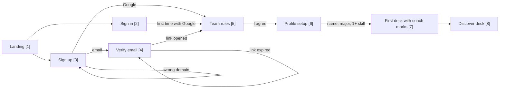
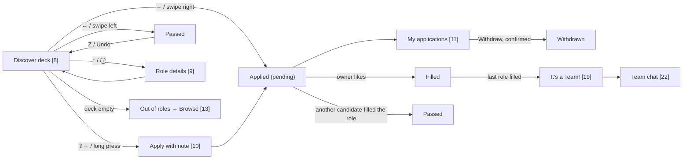
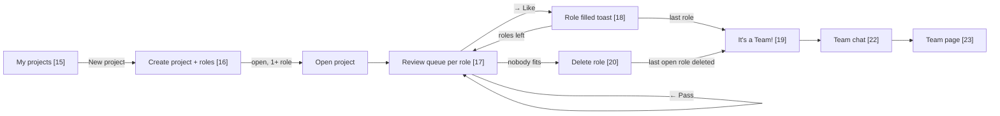

# User flows

The three journeys every screen serves. Numbers in brackets are screen numbers from [README.md](README.md). For the API calls behind each step, see [../../architecture/flows.md](../../architecture/flows.md).

The diagrams below render on GitHub. Image versions for slides or offline reading: [sign-up](img/flow-signup.png), [apply](img/flow-apply.png), [owner](img/flow-owner.png).

## 1. Sign up to first deck

- A wrong domain shows its error inline on sign-up and sign-in.
- Verification links last 3 days. The expired screen offers a new link.
- Profile setup is one question per screen on phone, and one form on desktop.

## 2. Candidate: apply to a role

- Undo only brings back a pass.
- Filled applications can't be withdrawn.
- When a team locks, its members are benched, and the deck shows the benched state until the term ends.

## 3. Owner: post a project to team chat

- An owner can have one open project at a time.
- A project needs at least one role before it can open.
- When a role fills, its other pending applicants become passed.
