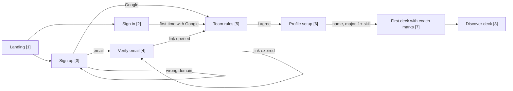
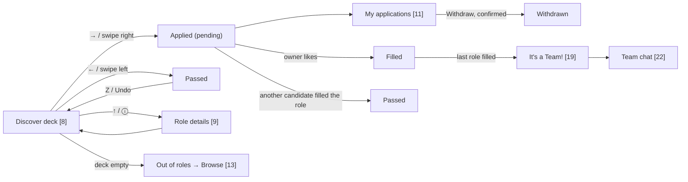
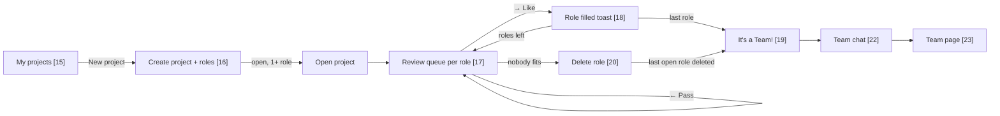
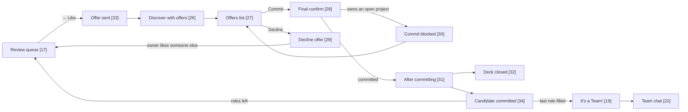
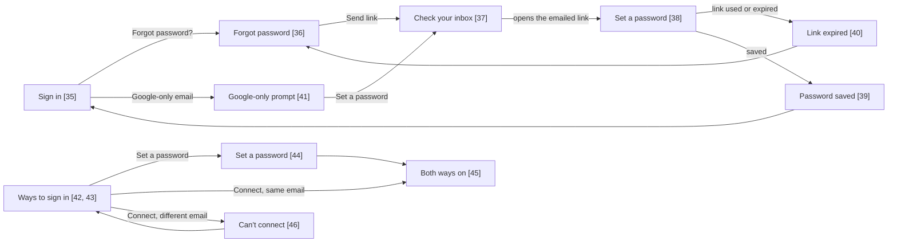
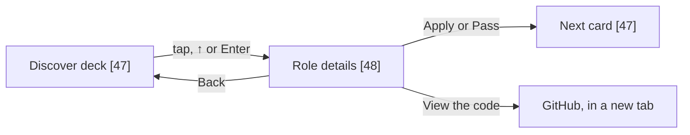
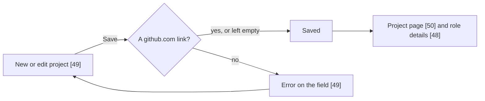
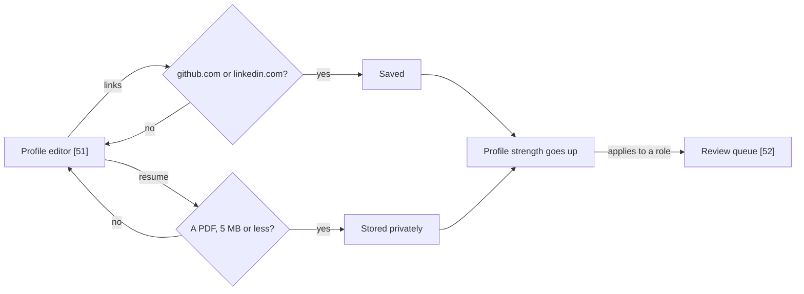
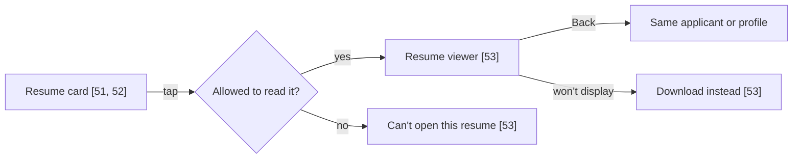

# User flows

The four journeys every screen serves, plus five that are planned. Numbers in brackets are screen numbers from [README.md](README.md). For the API calls behind each step, see [../../architecture/flows.md](../../architecture/flows.md).

The diagrams below render on GitHub. Image versions for slides or offline reading: [sign-up](img/flow-signup.png), [apply](img/flow-apply.png), [owner](img/flow-owner.png). The planned deck details flows, as drawn in the proposal: [deck to details](img/flow-deck-details.png), [repository](img/flow-repo-link.png), [links and resume](img/flow-profile-links.png), [reading a resume](img/flow-resume-viewer.png).

## 1. Sign up to first deck

- A wrong domain shows its error inline on sign-up and sign-in.
- Verification links last 3 days. The expired screen offers a new link.
- Profile setup is one question per screen on phone, and one form on desktop.

## 2. Candidate: apply to a role

- A swipe right applies with no note. The note goes on the role details page with F3-13 (DD-40).
- Undo only brings back a pass.
- Filled applications can't be withdrawn.
- When a team locks, its members are benched, and the deck shows the benched state until the term ends.

## 3. Owner: post a project to team chat

- An owner can have one open project at a time.
- A project needs at least one role before it can open.
- When a role fills, its other pending applicants become passed.

## 4. Candidate commits to one offer

Built in F4-10 and F4-11. It replaces the "owner likes" step in flows 2 and 3. See the [commit flow](../patterns/commit-flow.md) guide.

- A student can hold several offers at once. Committing closes the rest.
- The role stays open until someone commits, so the first commit wins.
- A commit can't be undone.

## 5. Planned: adding a way to sign in

Planned for F1-10, F1-12 and F1-13. See the [account paths](../patterns/account-paths.md) guide.

- Signed out, a password is always set through an emailed link, which proves the person owns the inbox.
- Signed in, Settings saves it directly.
- Connect only links a Google account with the same email as the account.

## 6. Planned: deck to details and back

Planned for UI-06 and F3-13. See the [deck details](../patterns/deck-details.md) guide. The deck keeps its place, so going back feels like you never left.

- Apply or Pass on the details page saves the decision, with the note if there is one.
- Opened from a link, Back goes to Discover.

## 7. Planned: owner adds a repository

Planned for F2-12. Optional, on create or edit.

- The server does the check. Nothing else on the form is lost.

## 8. Planned: candidate adds links and a resume

Planned for F1-15 and F1-16. Owners see them after the person applies.

- GitHub adds 5%, LinkedIn 5% and a resume 10% (DD-43, not agreed yet).
- The resume check reads the file itself, not just its name.

## 9. Planned: reading a resume

Planned for F1-17. It stays inside the app from start to finish.

- Only the person and owners of projects they applied to can read it (DD-42, not agreed yet).
- The file comes through our server after a permission check, so there's never a public link.
