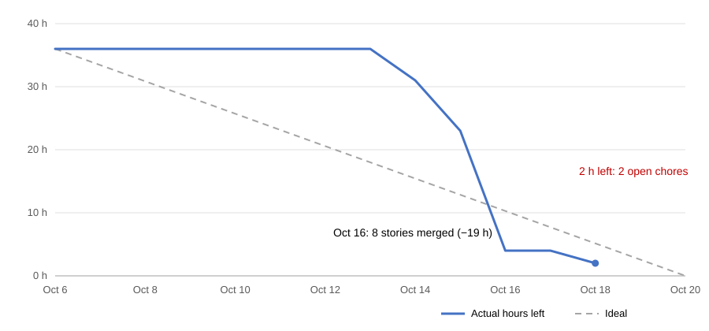

# Sprint 1 report

Sprint 1 ran Oct 6–20, 2026. This report reflects Oct 18; the sprint closes Oct 20.

**Goal:** a user can sign up and build a profile with skills, post a project with roles, another user can see roles in a feed and apply, and the owner can see applicants and like or pass. The team model and lock rule are tested. It runs on the production URL.

**Result:** all six parts are met. Production runs v1.0.1 at https://teammatch.sijancodes.com.

| | |
|---|---|
| Stories | 13 of 13 done (32 of 32 h) |
| Chores | 1 of 4 done; seed data is partly done |
| Pull requests | 25 merged by the team (Dependabot excluded) |
| Tests | 119 backend, 53 frontend; CI green on `main` |
| Production | v1.0.0 deployed Oct 18, then v1.0.1 the same night |

## Burn-down

36 hours were planned: 32 for stories and four 1-hour chores. Hrs Left on the board wasn't updated during the sprint, so the chart is rebuilt from the day each issue closed (Central time). Pull requests closed the issues as they merged, with two exceptions: #17 was closed by hand a minute after #92 merged, and #44 was closed once the deploy was verified.

Values for the spreadsheet:

| Date | Hours left | Ideal |
|---|---|---|
| Oct 6 | 36 | 36.0 |
| Oct 7 | 36 | 33.4 |
| Oct 8 | 36 | 30.9 |
| Oct 9 | 36 | 28.3 |
| Oct 10 | 36 | 25.7 |
| Oct 11 | 36 | 23.1 |
| Oct 12 | 36 | 20.6 |
| Oct 13 | 36 | 18.0 |
| Oct 14 | 31 | 15.4 |
| Oct 15 | 23 | 12.9 |
| Oct 16 | 4 | 10.3 |
| Oct 17 | 4 | 7.7 |
| Oct 18 | 3 | 5.1 |
| Oct 19 | | 2.6 |
| Oct 20 | | 0.0 |

## Done

| Story | Owner | Hours | Done | Pull requests |
|---|---|---|---|---|
| F1-01 Sign up with email and password | Weibo | 2 | Oct 14 | #77 |
| F1-02 Sign in and sign out | Weibo | 2 | Oct 15 | #89, fix #100 |
| F1-03 Create and edit my profile | Weibo | 2 | Oct 16 | #81, #91 |
| F1-04 Add skills to my profile | Weibo | 2 | Oct 16 | #82, #91 |
| F2-01 Create a project | Shree | 3 | Oct 15 | #79, #86, #88, #90 |
| F2-02 Add roles with required skills and publish | Shree | 3 | Oct 16 | #92, screen #101 |
| F2-03 List open projects | Shree | 2 | Oct 16 | #93, #94 |
| F3-01 Role feed (list view) | Pavan | 3 | Oct 14 | #80 |
| F3-02 Apply to a role with a note | Sijan, from Pavan | 3 | Oct 16 | #97 |
| F3-08 Role card component | Sijan, from Pavan | 2 | Oct 16 | #98 |
| F4-01 See applicants per role | Sijan | 3 | Oct 15 | #87, screen #99 |
| F4-02 Like or pass an applicant | Sijan | 2 | Oct 16 | #95, screen #99 |
| F4-03 Team model and lock rule | Sijan | 3 | Oct 16 | #96 |
| PL-05 First production deploy | Sijan | 1 | Oct 18 | #102, #103 |

Supporting work: model setup (#76), static files under uvicorn (#78), a profile created at sign-up (#83, in #87), verification email from TeamMatch through Resend (#102), and a deploy runbook (#102). Also a `bootstrap` step that adds the term and demo accounts after `migrate` (#103).

## Not done yet

| Chore | Status |
|---|---|
| PL-10 Seed data script (#45) | Term and demo accounts done in #103. Demo projects, including one that's a like away from locking, are still to do. |
| PL-11 Burn chart and report (#46) | This report. The chart still needs to go into the graded spreadsheet. |
| PL-12 Wiki/docs page (#49) | [Sprint 1 features](../product/sprint-1-features.md) |

Moved to Sprint 2 as planned: a like filling the role and locking the team (F4-05), the swipe deck (F3-03), and the review queue (F4-04). Ranking by skill match (F3-04) is Sprint 3.

## Retro

What went well:
- All 13 stories merged with tests, and the full flow works in the browser.
- One epic per person kept work parallel. Pavan's two stories were merged the day he left.
- The OpenAPI schema and generated client kept the front end and back end in step.
- Review and browser testing caught real bugs: four sign-up bugs, and the sign-in redirect.

What didn't:
- Work came in late: 1 pull request in the first six days, 8 on Oct 16.
- The chores had no owner until Oct 16. Production was updated only on Oct 18.
- Stacked pull requests all targeted `main`, which forced rebases and schema conflicts.
- Three pull requests went past the 400-line guideline (#77, #89, #91).
- The board drifted until Oct 18, and most reviews waited on the lead.

Actions for Sprint 2, to confirm at planning on Oct 22:
1. Re-plan for three people: 30 hours per sprint, not 40.
2. Name an owner for every chore at planning, and deploy on day 7 as well as at the end.
3. Merge a first pull request by day 3, and keep pull requests under 400 lines.
4. Base stacked pull requests on their parent branch.
5. Every pull request gets a reviewer other than the lead within 24 hours.
6. Update the board at every standup.
7. Add the Playwright smoke test (PL-14) early.
