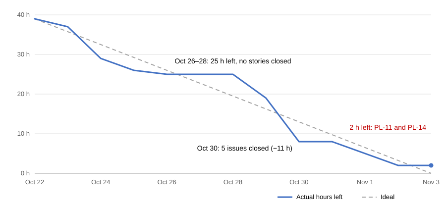

# Sprint 2 report

Sprint 2 ran Oct 22–Nov 3, 2026. This report was written on Nov 8, after the sprint ended.

**Goal:** swiping works, likes fill roles, teams lock on their own with auto-withdraw and retire, and Google sign-in with the domain allowlist is live.

**Result:** all four parts are met. Swiping (F3-03, F3-05, F3-09), likes that fill a role and lock the team (F4-05), auto-withdraw and retire (F4-07, F1-08), and Google sign-in with the allowlist (F1-05, F1-06) were all on `main` by Nov 2. v2.1.0 was tagged that day, and the production sign-in config lists Google (checked Nov 8).

| | |
|---|---|
| Stories | 14 of 14 planned done (35 of 35 h) |
| Chores | 2 of 4 done (PL-06, PL-13); PL-11 is this report; PL-14 is not done |
| Added during the sprint | 6 issues that weren't in the plan (6 h) and one bug fix, plus 2 h more on F3-03 and F4-05 than planned |
| Closed on the board | 45 h by board estimates: 37 of the 39 planned, 6 added, 2 re-estimated |
| Pull requests | 50 merged by the team (Dependabot excluded) |
| Tests | 261 backend, 199 frontend; CI green on `main` at the last merge of the sprint (Nov 2) |
| Releases | 7 tags, v1.0.3 to v2.1.0; v2.1.0 on Nov 2 |

## Burn-down

39 hours were planned in the [sprint plan](sprint-plan.md): 35 for stories and four 1-hour chores. Code reviews aren't on the board, so they're left out, as in the [Sprint 1 report](sprint-1-report.md). The plan and the course retro date end the sprint on Nov 3, which the chart uses. The board iteration is 14 days from Oct 22.

The board only holds today's Hrs Left, not a daily history, and two closed issues still show hours left (F4-04: 3, UI-03: 1). So, as in Sprint 1, the chart is rebuilt from the day each issue closed (Central time), using the hours in the sprint plan. Pull requests closed most issues as they merged. Where they didn't:

- **F2-04 (#19):** PR #132 merged on Oct 25. The issue was closed by hand on Nov 2 with the comment "Shipped in #132". Counted on Oct 25.
- **F1-05 (#10):** closed on Oct 25 by the backend PR #131, whose description says the frontend half closes the story. The frontend (#150) merged on Oct 29. Counted on Oct 29.
- **F1-08 (#12):** the plan has it in Sprint 2, but the board lists it under S3 and it had no assignee until Nov 1. Sijan finished it on Nov 2 (#181). Counted on Nov 2.
- **Not counted:** BUF-B2 (1 h, closed as not planned on Oct 22) and DS-02 (2 h, closed as a duplicate of PL-16).
- **PL-11 (this report):** closed on Nov 8 with no report in the repo, so its hour is still left at the end of the sprint, with PL-14.
- **F3-03 and F4-05:** the chart uses the plan's 4 h and 3 h. The board now says 5 h and 4 h; the extra 2 h are in "Also done" below, not in the chart.

Values for the spreadsheet:

| Date | Hours left | Ideal |
|---|---|---|
| Oct 22 | 39 | 39.0 |
| Oct 23 | 37 | 35.8 |
| Oct 24 | 29 | 32.5 |
| Oct 25 | 26 | 29.3 |
| Oct 26 | 25 | 26.0 |
| Oct 27 | 25 | 22.8 |
| Oct 28 | 25 | 19.5 |
| Oct 29 | 19 | 16.3 |
| Oct 30 | 8 | 13.0 |
| Oct 31 | 8 | 9.8 |
| Nov 1 | 5 | 6.5 |
| Nov 2 | 2 | 3.3 |
| Nov 3 | 2 | 0.0 |

## Workload

Sijan carried slot C (F3, 8 h, after Pavan left), slot D (F4, 8 h) and PL-16 app shell (3 h): 19 h of stories against the 10 h plan. Sijan chose to keep that load at planning on Oct 22. With a review and a chore, the plan had Sijan at 21 h; Weibo and Shree were at 10 h each.

Hours closed, by board assignee and board estimates, counting the added work:

| Owner | Planned stories | Stories closed | Chores closed | Total |
|---|---|---|---|---|
| Weibo | 8 | 10 | 0 | 10 |
| Shree | 8 | 12 | 1 | 13 |
| Sijan | 19 | 21 | 1 | 22 |

Some work moved from the plan. Shree took F4-04 (3 h) and Weibo took F3-06 (3 h), both planned for Sijan. Sijan took F1-08 (3 h), planned for Weibo. The board credits F1-05 to Weibo, though Sijan wrote its backend (#131). Pull requests merged: Sijan 29, Shree 15, Weibo 6.

## Done

| Story | Owner | Hours | Done | Pull requests |
|---|---|---|---|---|
| F1-05 Sign in with Google | Weibo, backend by Sijan | 3 | Oct 29 | #131, #150, docs #134 |
| F1-06 Email domain allowlist | Weibo | 2 | Oct 24 | #129 |
| F1-08 Retired users blocked and term reset | Sijan, planned for Weibo | 3 | Nov 2 | #181 |
| F2-04 Project detail page | Shree | 2 | Oct 25 | #132 |
| F2-05 Edit and close a project | Shree | 3 | Oct 24 | #127, #128 |
| F2-06 Delete an unfillable role | Shree | 2 | Oct 23 | #125 |
| F2-11 One open project per owner | Shree | 1 | Oct 30 | #124, #164 |
| F3-03 Swipe deck | Sijan | 4 | Oct 30 | #156 |
| F3-05 Pass on a role | Sijan | 1 | Oct 30 | #155 |
| F3-06 My applications and withdraw | Weibo, planned for Sijan | 3 | Oct 29 | #142, #148 |
| F4-04 Review queue UI | Shree, planned for Sijan | 3 | Nov 1 | #168, #169, #170 |
| F4-05 Mutual like fills the role and locks the team | Sijan | 3 | Oct 30 | #151, #162 |
| F4-07 Auto-withdraw and retire on lock | Sijan | 2 | Oct 30 | #161 |
| PL-16 App shell and navigation | Sijan | 3 | Oct 24 | #130 |
| PL-06 Cut release tag and deploy | Sijan | 1 | Oct 25 | #138, tags v1.0.3 to v2.1.0 |
| PL-13 API docs refresh | Shree | 1 | Oct 26 | #145 |

Also done, not in the plan:

| Item | Owner | Hours | Done | Pull requests |
|---|---|---|---|---|
| DS-01 Design system tokens and core components (#111) | Sijan | 1 | Oct 22 | #118, #119 |
| F3-09 Keyboard and button swipe controls (#33), planned for Sprint 3 | Sijan | 1 | Oct 30 | #158 |
| UI-01 Restyle landing and auth screens (#113) | Weibo | 1 | Oct 30 | #165 |
| UI-02 Profile preview and edit (#114) | Sijan | 1 | Oct 31 | #167 |
| UI-03 Projects Browse and Mine restyle (#115) | Shree | 1 | Oct 30 | #159, #160, #163 |
| UI-04 Settings: theme and log out (#116) | Weibo | 1 | Oct 31 | #166 |
| Unreadable text when the app theme differs (#146), a bug | Shree | none | Oct 29 | #147, #149 |

The board estimates F3-03 at 5 h and F4-05 at 4 h, 1 h each above the plan.

Supporting work: the wiki mirror on every merge (#117), the Lineup landing page (#123), the wrong-domain error wording (#133), a fix for a 500 when signing up with a taken email (#136), release and deploy workflow fixes (#137, #139, #141, #153), README badges (#154), a same-origin `?next=` fix after sign-in (#171), and four fixes on Nov 2: signing the old account out when signing in over it (#174), clearing cached data when the user changes (#176), one team per person per term (#178), and one seat per person per team (#180).

## Not done yet

| Item | Status |
|---|---|
| PL-14 Playwright setup and smoke test (#53) | Not done. No Playwright test is in the repo, and the board still shows 1 h left. The Sprint 3 plan merges it into PL-08, the golden-path end-to-end test (#54). |
| PL-11 Burn chart and sprint report (#47) | This report. #47 was closed on Nov 8 with no report in the repo; this pull request refs it. The chart still needs to go into the graded spreadsheet (see the values above). |
| Board tidy | Hrs Left still shows 3 on F4-04 and 1 on UI-03, though both are closed and should be 0. F1-08 (#12) sits under S3 on the board; the plan has it in S2. |

## Retro

These points come from the board, pull requests and CI, not from a team discussion.

What went well:
- All 14 planned stories (35 of 35 h) merged, and the goal is met.
- Pull requests started on day one: 5 merged on Oct 22 and 2 on Oct 23.
- Reviews were quick when they happened: 31 of 50 pull requests got a review from someone other than the author, all within 24 hours of opening.
- Tests grew from 119 backend and 53 frontend (Sprint 1 report) to 261 and 199, with CI green on `main`.
- Seven release tags in the sprint, the last one (v2.1.0) on Nov 2.

What didn't:
- Closing came late and in a bunch. No story closed Oct 26–28, and 13 of the 50 pull requests and 11 of the 39 planned hours landed on Oct 30.
- 19 of 50 pull requests merged with no review from someone else: 18 of Sijan's 29 and 1 of Weibo's 6. All 15 of Shree's were reviewed.
- 12 pull requests were over 400 changed lines (#118, #119, #123, #127, #130, #142, #148, #150, #151, #156, #162, #168). The count includes generated client files, which the guideline leaves out.
- The plan was 41 h (10, 10 and 21), not 30. Sijan's 19 h of planned stories closed at 21 h by board owner.
- The plan and the board drifted: F1-08 was in the plan but under S3 on the board, F3-09 was pulled in from Sprint 3, six issues were added, two were re-estimated, and Hrs Left was left stale on two closed issues.
- PL-14 wasn't done, and this report wasn't written until Nov 8, five days after the sprint ended.

Sprint 1 listed seven actions to confirm at planning on Oct 22. The repo doesn't record which ones the team confirmed. This is what the data shows for each:

| Action | What the data shows |
|---|---|
| 1. Re-plan for three people, 30 h per sprint | The plan came to 41 h. Sijan kept the extra on Oct 22. |
| 2. Name an owner for every chore at planning; deploy on day 7 as well as at the end | All four chores had an assignee on Oct 22: Weibo PL-11, Shree PL-13, Sijan PL-06 and PL-14. Tags on Oct 22, 25, 30, 31 and Nov 2; none on Oct 28 (day 7). |
| 3. First pull request by day 3, under 400 lines | First merges on Oct 22 and Oct 23. 12 of 50 went over 400 changed lines. |
| 4. Base stacked pull requests on their parent branch | Not checked. |
| 5. A reviewer other than the lead within 24 hours | 31 of 50 had a review, all within 24 hours; 15 had one from a teammate other than Sijan. 19 had none. |
| 6. Update the board at every standup | The board keeps no Hrs Left history to check. Two closed issues still show hours left. |
| 7. Add the Playwright smoke test (PL-14) early | PL-14 was not done. |
