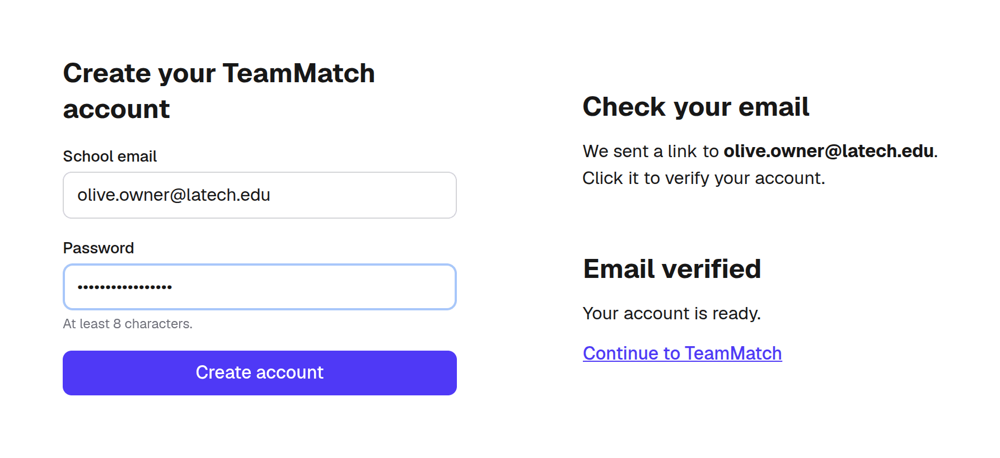
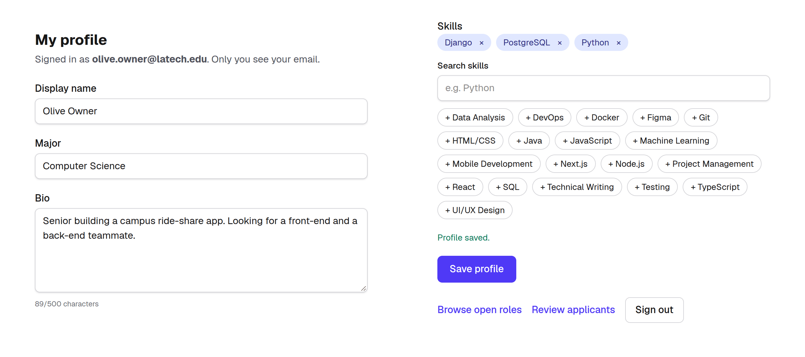
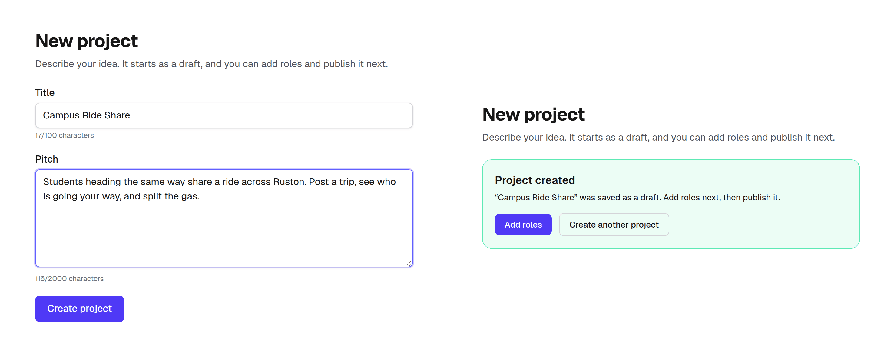
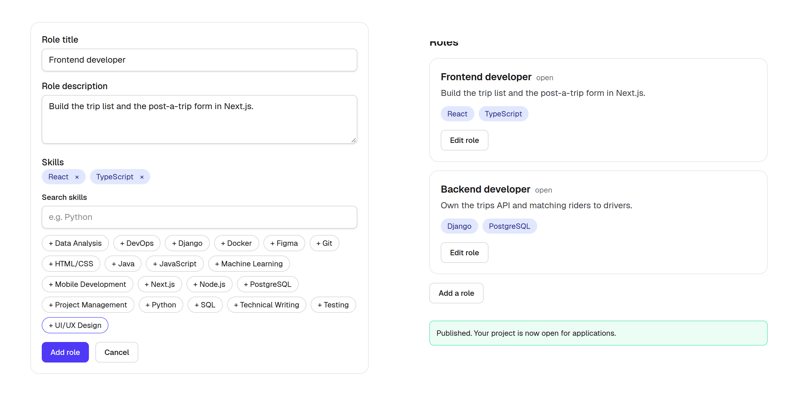
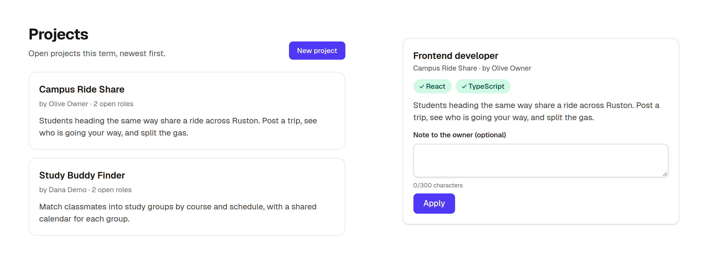
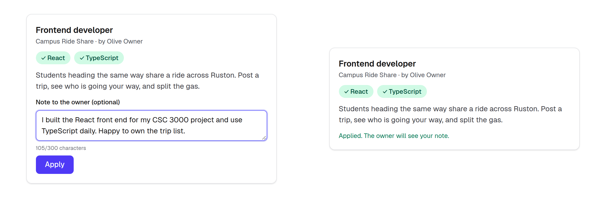
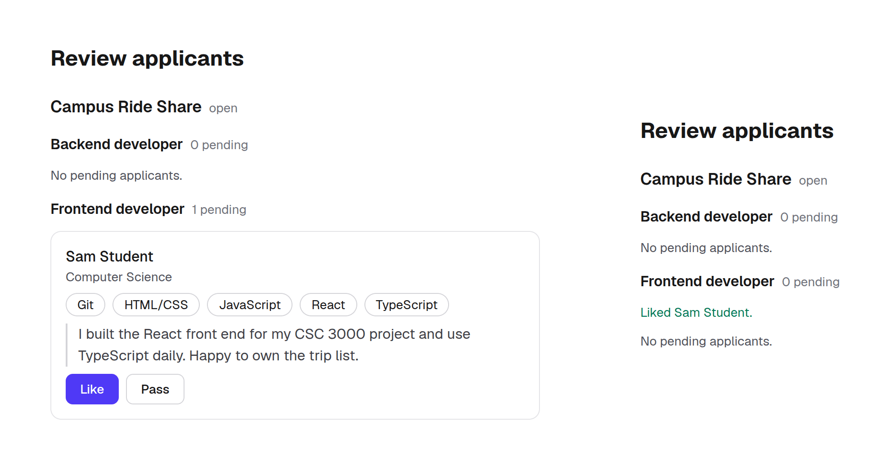

# Sprint 1 features

What Sprint 1 shipped, and how to try each part. Everything here is live in v1.0.1 at https://teammatch.sijancodes.com. The screenshots come from a local run of the same version. The [Sprint 1 report](../planning/sprint-1-report.md) has the numbers.

The flow uses two people. An **owner** posts a project with open roles. A **candidate** finds a role that fits their skills and applies. The owner then likes or passes.

## 1. Sign up and verify your email (F1-01, F1-02)

1. Open `/signup`. Enter a school email and a password of at least 8 characters.
2. The page says "Check your email." The email comes from `TeamMatch <verification@teammatch.sijancodes.com>`.
3. Click the link. The page shows **Verify my email**; click it to see "Email verified."
4. Sign in at `/login`. If a protected page sent you to sign in, you land back on that page.

Signing in before you verify says "Please verify your email first" and sends a fresh link. A link expires after 3 days.

## 2. Build a profile with skills (F1-03, F1-04)

On **My profile**, add a display name, your major, a short bio, and skills from the list of 22. Save the profile. Only you see your email.

## 3. Create a project (F2-01)

Go to **Projects**, then **New project**. Give it a title and a pitch. It's saved as a draft in the current term, and the confirmation links to **Add roles**.

## 4. Add roles and publish (F2-02)

On the project page, use **Add a role** for each role: a title, a description, and the skills it needs. Then click **Publish project**. The status changes from draft to open.

## 5. Browse projects and roles (F2-03, F3-01, F3-08)

**Projects** lists open projects, newest first, with their open-role count. **Browse open roles** (`/feed`) shows a card for each open role. Skills you already have are marked. Owners don't see their own roles there.

## 6. Apply with a note (F3-02)

On a role card, write an optional note to the owner (up to 300 characters) and click **Apply**. The card says "Applied. The owner will see your note." After a reload the role leaves your feed.

## 7. Review applicants and like or pass (F4-01, F4-02)

The owner opens **Review applicants**. Pending applicants are grouped by project and role, with their name, major, skills and note. Their email isn't shown. Click **Like** or **Pass**; each application takes one decision.

## Behind the scenes (F4-03)

The team model and the lock rule are in the backend and tested. A team locks when every role is filled. A like doesn't fill a role yet; that's F4-05 in Sprint 2.

## Try it locally

Start the stack with `make up` and open http://localhost:3000. On a fresh database, `bootstrap` adds the Fall 2026 term after `migrate`. Set the `SEED_*` lines in your `.env` (see `deploy/README.md`) to get demo accounts that are already verified. Run `make seed` to add five sample projects with open roles. Locally, verification emails are printed in the API log (`docker compose logs api`).

## Not in Sprint 1

- A like filling the role and locking the team (F4-05, Sprint 2)
- The swipe deck (F3-03, Sprint 2)
- Ranking roles by skill match (F3-04, Sprint 3)
